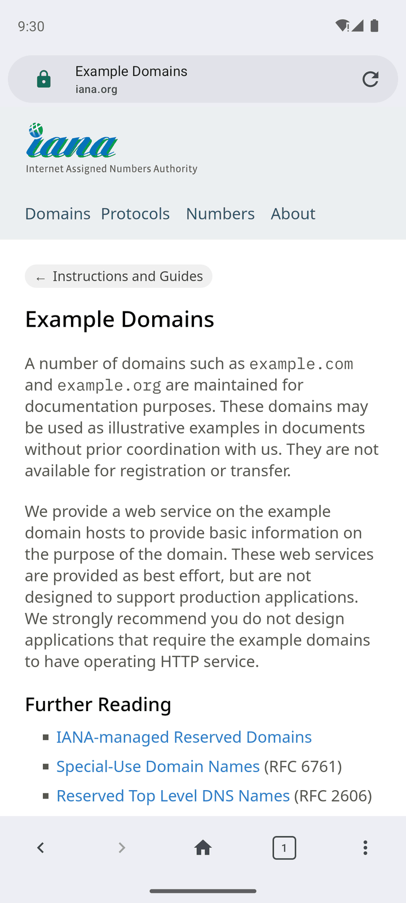
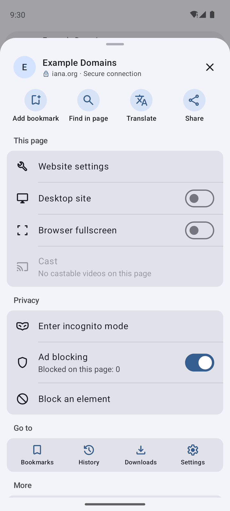
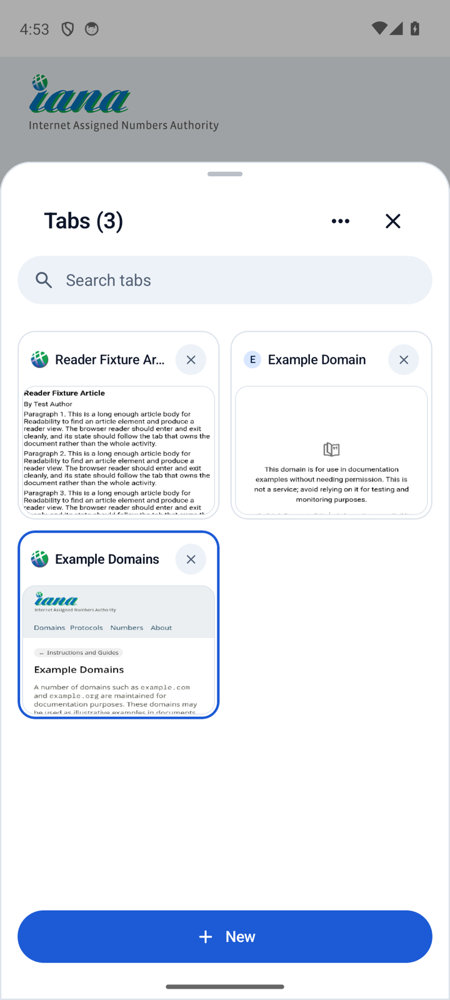
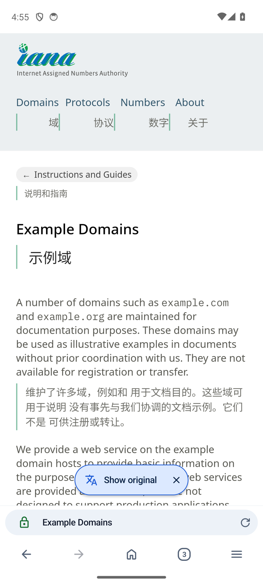
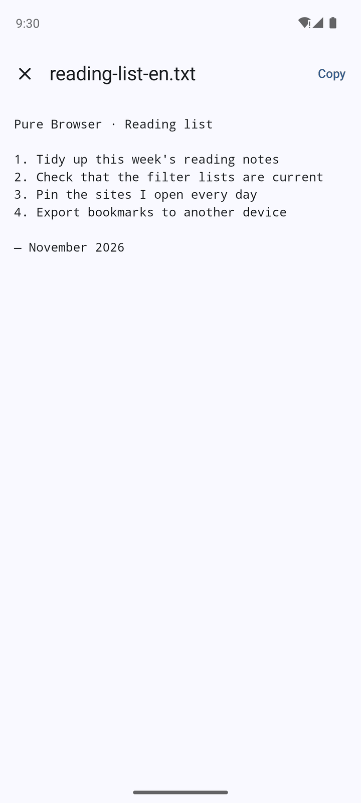
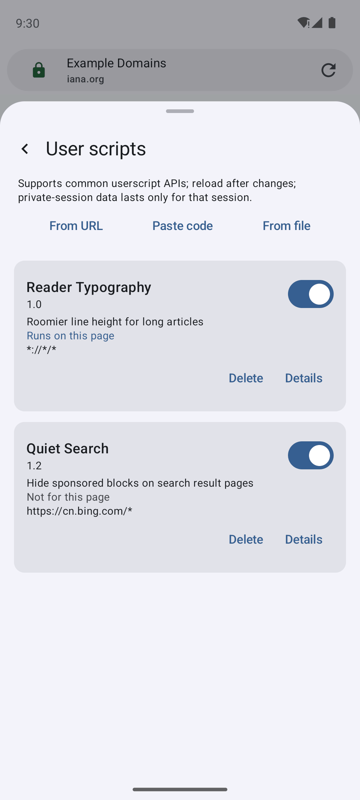
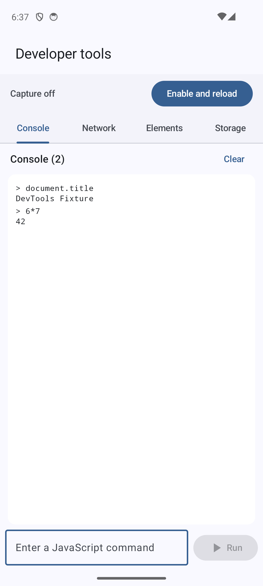
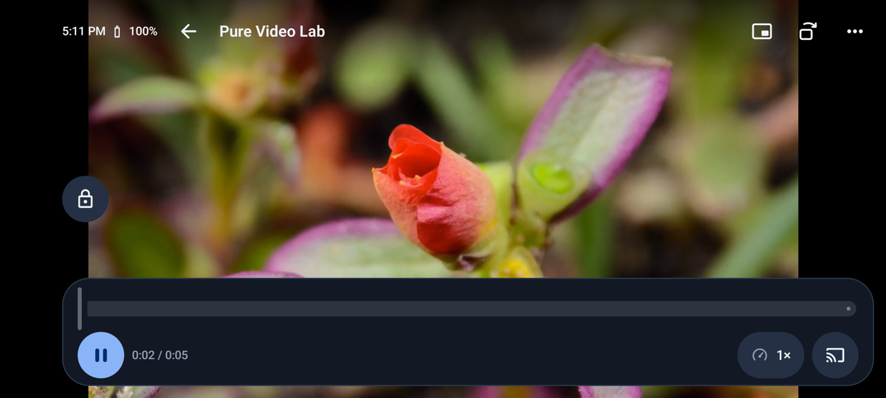

# Pure Browser

[中文](README.md) · [English](README.en.md) · [Documentation](docs/README.md)

[](https://github.com/Nobilta/pure-browser/actions/workflows/ci.yml)
[](https://github.com/Nobilta/pure-browser/releases/latest)
[](LICENSE)
[](#install)

Pure Browser is an open-source Android browser built on the system WebView. It uses Material Design 3 for its interface and includes reader mode, enhanced video playback, ad blocking and developer tools.

**[Download the latest version](https://github.com/Nobilta/pure-browser/releases/latest)** · [Screenshots](#screenshots) · [Report an issue](https://github.com/Nobilta/pure-browser/issues)

Requires Android 10 or later on an ARM64 device running 64-bit Android.

## Core features

- **Enhanced video player**: playback speed, brightness and volume gestures, picture-in-picture and DLNA casting. With background playback enabled, fullscreen video can keep playing while the screen is locked and enter picture-in-picture when you return to the home screen.
- **Reading and translation**: reader mode extracts the article with adjustable text size, line spacing and paper colours. Translate full pages into a bilingual view or translate selected text, using the built-in service without signing in or a custom API.
- **Ad blocking and userscripts**: bundled subscriptions including EasyList and EasyPrivacy, optional app-banner and cookie-notice filters, custom subscriptions, manual element blocking and userscript installation.
- **Tabs, bookmarks and history**: tab search and groups, find in page, bookmark folders and drag sorting, bulk actions, bookmark import and export, and history search.
- **Downloads**: choose a filename and folder before downloading, search and filter tasks, view details, pause or resume selected tasks, and set concurrency and total HTTP speed limits. Supports HTTP(S), FTP and HLS VOD downloads.
- **Developer tools**: inspect the console, network requests, DOM tree and source, Cookies, Local Storage and Session Storage, with search, refresh and copy tools.
- **QR codes and images**: create a QR code for the current page or scan codes offline with the camera or an image. Long-press an image to save, share or search by image, with independently selectable or custom image search providers.
- **Local text and printing**: read plain text, Markdown, JSON, XML, YAML and CSV files in a read-only viewer. Print web pages or save them as PDF through the system print sheet.
- **Personalisation and fullscreen**: customise the home page, address bar position, light or dark theme, and per-site browser identity. Supports Simplified Chinese, Traditional Chinese and English, settings import and export, and fullscreen browsing with the toolbar and system bars hidden.
- **Incognito and privacy**: incognito visits do not enter browsing history, and session data is cleared when you leave. Explicitly saved bookmarks, settings, download records and files remain. Accepted incognito downloads can finish, but cannot be resumed or retried across sessions after leaving. Website permissions and browsing data cleanup are also available.

See the [feature guide](docs/features.md) for usage, WebView compatibility, supported HLS formats and incognito isolation limits.

## Screenshots

Browsing, menu, tabs and bilingual translation:

| Browsing | Menu | Tabs | Bilingual translation |
|---|---|---|---|
|  |  |  |  |

Local text, userscripts and developer tools:

| Local text | User scripts | Developer tools |
|---|---|---|
|  |  |  |

Enhanced video playback in landscape:



## Install

1. Open the [latest release](https://github.com/Nobilta/pure-browser/releases/latest) on your phone and download `PureBrowser-v<version>-release.apk` from **Assets**.
2. Open the APK. If prompted, allow app installs from the source you used to download it.
3. Follow the Android installation prompts.

> **Download failing on some networks?**
> GitHub serves release assets from `release-assets.githubusercontent.com`, which can time out or stall at 0%
> on some networks. Use the Gitee mirror for the same release instead:
> <https://gitee.com/Nobilta/pure-browser/releases>
> If Gitee is unavailable too, prefix the GitHub download URL with `https://ghproxy.net/` as a fallback.
> Verify the file against `SHA256SUMS` from the same release (`sha256sum -c SHA256SUMS`).

To upgrade, install the new version over the existing app to keep your bookmarks and settings.
**You do not need to uninstall first.** The app also checks for updates at startup; you can turn this off
or check manually in **Settings → About**.
In-app updates prefer Gitee and automatically fall back to GitHub when the network or service is unavailable, for both checks and downloads. There is no source selection to configure.

See the [changelog](docs/changelog.md) for the update history.

## Build from source

The project uses Kotlin, Jetpack Compose and Rust. Builds support macOS, Linux and Windows;
on Windows run the scripts from Git Bash.
Follow the [development setup guide](docs/building.md#环境与版本来源) to install the JDK, Android SDK/NDK, Rust, Node.js and Python.

```bash
git clone https://github.com/Nobilta/pure-browser.git
cd pure-browser
./build-and-test.sh --quick      # Run automated checks
./gradlew :app:assembleDebug     # Build an installable debug APK
# ./build-and-test.sh --release  # Sign a release APK and run release checks
```

The debug APK is at `app/build/outputs/apk/debug/app-debug.apk` and can be installed alongside the official release.
Builds target ARM64 by default. See the [build guide](docs/building.md#宿主设备和-apk-架构) for emulator setup and ABI selection
and the [release guide](docs/releasing.md) for signing and publishing.
On Windows Git Bash, use `PYTHON=python ./build-and-test.sh --quick` if you need to select the Python interpreter.
`--release` requires signing credentials. See the [testing guide](docs/testing.md) for checks, device regressions and script organisation.

See the [architecture guide](docs/architecture.md) for the code structure and follow the [UI design system](docs/design-system.md) when changing the interface.
Changes involving incognito must follow the [incognito design contract](docs/incognito-policy.md): share explicitly saved outputs and preferences, isolate session data, and preserve ordinary features and accepted downloads.

## Feedback and contributions

Found a bug or have an idea? [Open an issue](https://github.com/Nobilta/pure-browser/issues).
For bugs, include the app version, Android version and steps to reproduce.
Please report security vulnerabilities privately using the [security policy](SECURITY.md).

Pull requests are welcome. Read the [contribution guidelines](docs/testing.md#开发约定) and [code of conduct](CODE_OF_CONDUCT.md) to get started.

## License

The project code is licensed under the [MIT License](LICENSE).
Filter lists and other third-party components have their own licences, listed in [third-party notices](docs/third-party-notices.md).
