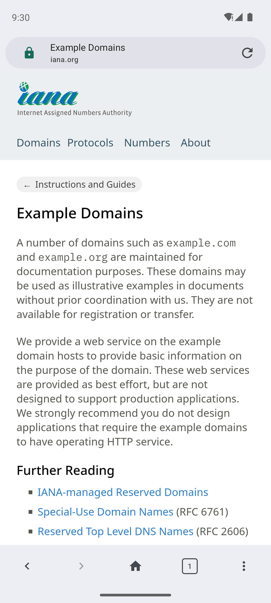
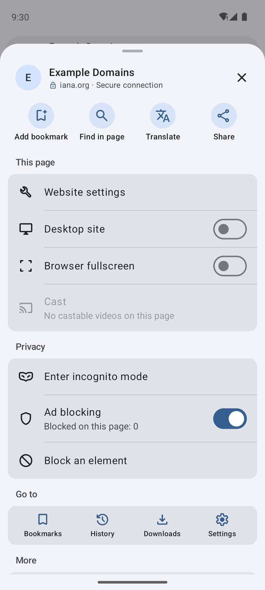
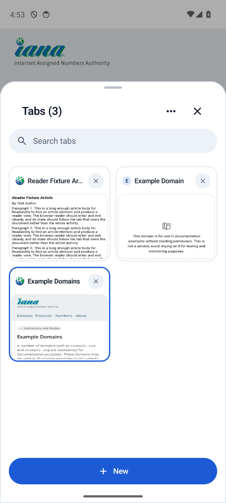
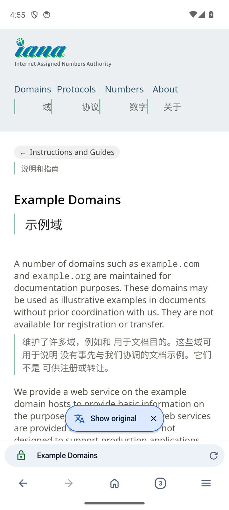
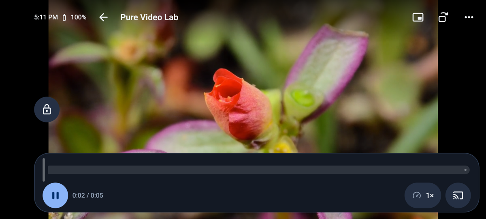
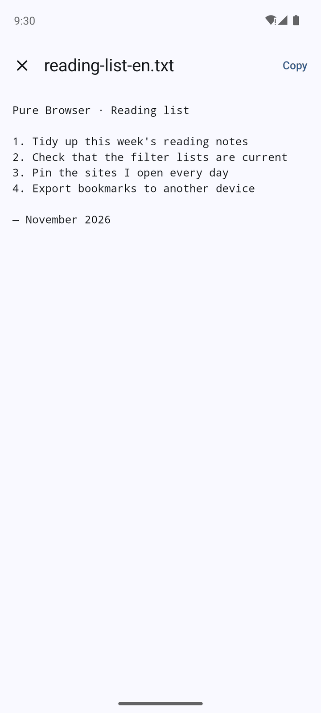
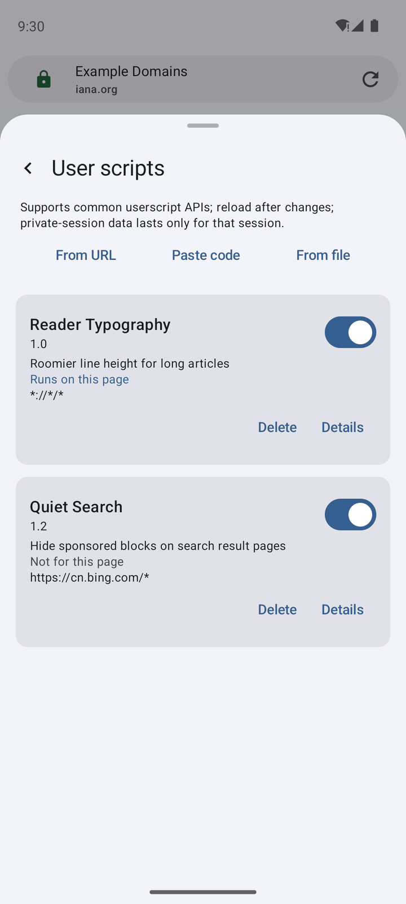
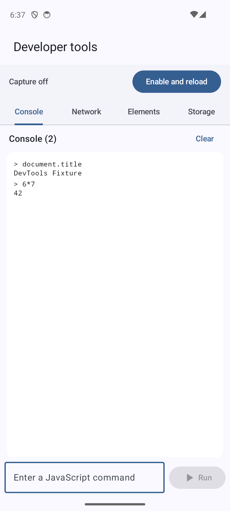

# Pure Browser

[中文](README.md) · [English](README.en.md)

[](https://github.com/Nobilta/pure-browser/actions/workflows/ci.yml)
[](https://github.com/Nobilta/pure-browser/releases/latest)
[](LICENSE)
[](#install)

Pure Browser is an open-source Android browser built on the system WebView, with an interface designed to the Material Design 3 specification.

**[Download the latest version](https://github.com/Nobilta/pure-browser/releases/latest)** · [Screenshots](#screenshots) · [Report an issue](https://github.com/Nobilta/pure-browser/issues)

Requires Android 10 or later on an ARM64 device running 64-bit Android.

## Core features

- **Enhanced video player**: supports playback speed, brightness and volume gestures, picture-in-picture, background playback and DLNA casting.
- **Page translation**: full-page bilingual translation and selected-text translation; includes a built-in no-login service and supports custom translation APIs.
- **Local plain text**: opens common text files (`text/plain`, YAML, JSON, XML, Markdown, CSV and similar).
- **Developer tools**: console, network request details, DOM tree and current-DOM source, Cookies, Local Storage and Session Storage; enhanced capture is enabled per tab by installing its script before reloading the page.
- **Ad blocking and userscripts**: built-in filter rules, custom subscriptions and userscript installation.
- **Tabs and bookmarks**: tab groups and search, find in page, bookmark import and export.
- **Reader mode and printing**: one-tap reflow of the body into reader mode; print pages or save them as PDF from the system print sheet.
- **Downloads**: pause and resume downloads and choose custom folders.
- **Immersive fullscreen**: hides the system bars and toolbar so the page fills the screen.
- **Offline QR scanning**: scan QR codes with the camera or an image, without an internet connection.
- **Personalisation**: customise the home page, address bar position, theme and three interface languages; set a per-site browser identity; settings can be exported to a file and imported on another device.
- **Privacy controls**: built-in incognito browsing, per-site permissions and browsing data cleanup.

## Screenshots

Browsing, menu, tabs and bilingual translation:

| Browsing | Menu | Tabs | Bilingual translation |
|---|---|---|---|
|  |  |  |  |

Enhanced video, local text, userscripts and developer tools:

| Enhanced video | Local text | User scripts | Developer tools |
|---|---|---|---|
|  |  |  |  |

See the [feature guide](FEATURES.md) for details, website compatibility and incognito limitations.

## Install

1. Open the [latest release](https://github.com/Nobilta/pure-browser/releases/latest) on your phone and download `PureBrowser-v<version>-release.apk` from **Assets**.
2. Open the APK. If prompted, allow app installs from the source you used to download it.
3. Follow the Android installation prompts.

To upgrade, install the new version over the existing app to keep your bookmarks and settings.
**You do not need to uninstall first.** The app also checks for updates at startup; you can turn this off
or check manually in **Settings → About**.

See the [changelog](CHANGELOG.md) for changes in each version.

## Build from source

The project uses Kotlin, Jetpack Compose and Rust. Builds support macOS, Linux and Windows;
on Windows run the scripts from Git Bash.
Follow the [development setup guide](CONTRIBUTING.md#开发环境) to install the JDK, Android SDK/NDK, Rust, Node.js and Python.

```bash
git clone https://github.com/Nobilta/pure-browser.git
cd pure-browser
./build-and-test.sh --quick      # Run automated checks
./gradlew :app:assembleDebug     # Build an installable debug APK
# ./build-and-test.sh --release  # Sign a release APK and run release checks
```

The debug APK is at `app/build/outputs/apk/debug/app-debug.apk` and can be installed alongside the official release.
Builds target ARM64 by default. See the [testing guide](TESTING_GUIDE.md) for emulator setup
and the [release guide](RELEASING.md) for signing and publishing.
Quick checks include release tooling tests; `--release` also signs and verifies the release APK. Official builds are signed and tested on an emulator locally.
After pushing to `main` and passing CI, use `release/publish.sh` to create a GitHub Release draft,
review it, then publish it manually as latest.

The [architecture guide](ARCHITECTURE.md) introduces the codebase, including the boundaries between page navigation,
download record storage and shared settings components.

## Feedback and contributions

Found a bug or have an idea? [Open an issue](https://github.com/Nobilta/pure-browser/issues).
For bugs, include the app version, Android version and steps to reproduce.
Please report security vulnerabilities privately using the [security policy](SECURITY.md).

Pull requests are welcome. Read the [contributing guide](CONTRIBUTING.md) and [code of conduct](CODE_OF_CONDUCT.md) to get started.

## License

The project code is licensed under the [MIT License](LICENSE).
Filter lists and other third-party components have their own licences, listed in [third-party notices](THIRD_PARTY_NOTICES.md).
