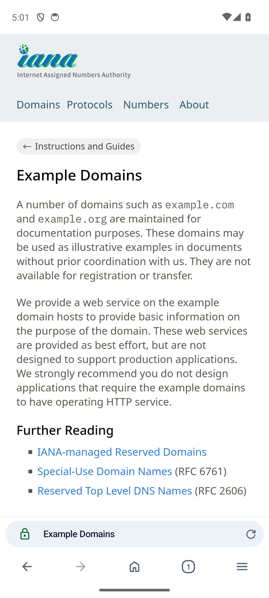
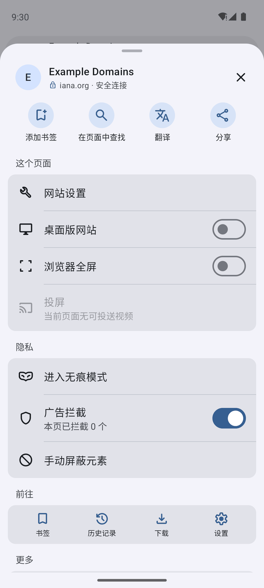
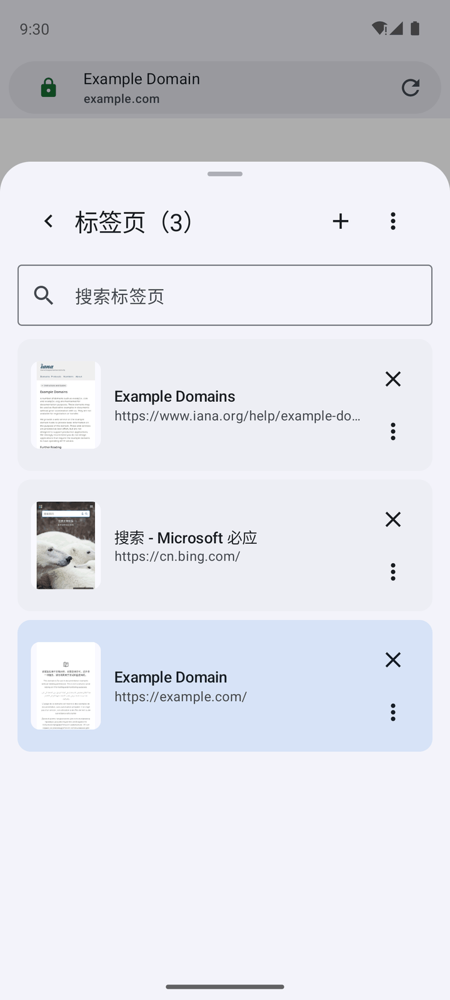
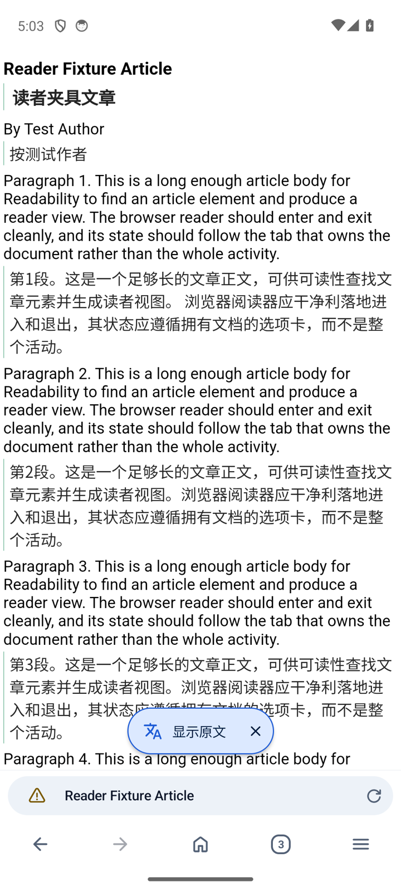
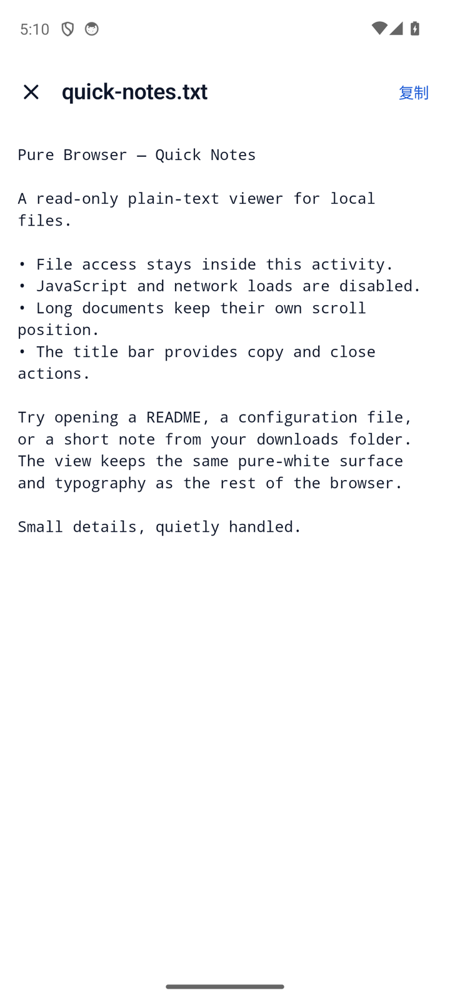
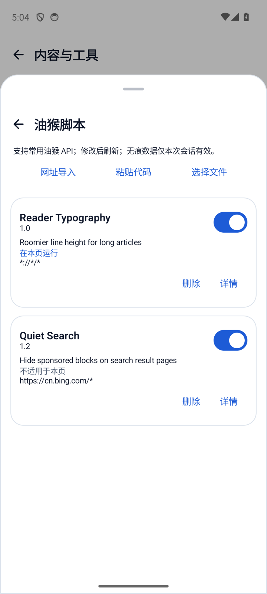
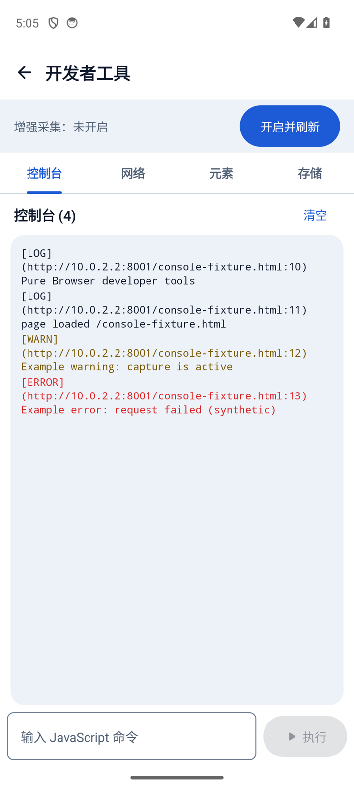
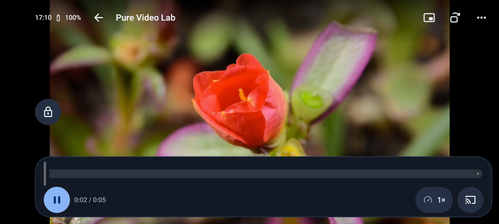

# Pure 浏览器

[中文](README.md) · [English](README.en.md) · [文档中心](docs/README.md)

[](https://github.com/Nobilta/pure-browser/actions/workflows/ci.yml)
[](https://github.com/Nobilta/pure-browser/releases/latest)
[](LICENSE)
[](#安装)

Pure 浏览器是一款基于系统 WebView 的开源 Android 浏览器，采用 Material Design 3 构建界面，提供网页阅读、视频增强、广告过滤和开发者工具。

**[下载最新版](https://github.com/Nobilta/pure-browser/releases/latest)** · [查看截图](#截图) · [反馈问题](https://github.com/Nobilta/pure-browser/issues)

支持 Android 10 及以上的 ARM64 设备（64 位 Android 系统）。

## 核心功能

- **增强型视频播放器**：倍速播放、亮度与音量手势、画中画和 DLNA 投屏。开启后台播放后，全屏视频可在锁屏时继续播放，返回桌面可进入画中画。
- **阅读与翻译**：阅读模式提取正文，可调字号、行距和纸张底色；支持全文双语对照和选中文本翻译，内置免登录翻译服务，也可配置自定义 API。
- **广告过滤与用户脚本**：内置 EasyList、EasyPrivacy 等过滤订阅，可选 App 引导与 Cookie 提示过滤，支持自定义订阅、手动屏蔽元素和安装用户脚本。
- **标签、书签与历史**：标签搜索和分组、页内查找、书签文件夹与拖动排序、批量操作，以及书签导入导出和历史搜索。
- **下载管理**：下载前修改文件名和保存目录，搜索和筛选任务、查看详情、批量暂停与继续，为失效链接更新地址并校验续传，设置并发数和 HTTP 总限速；支持 HTTP(S)、FTP 及 HLS 点播下载。
- **开发者工具**：查看控制台、网络请求、DOM 树与源码，以及 Cookies、Local Storage 和 Session Storage；支持控制台筛选与命令历史、元素拾取与临时编辑，以及 Local／Session Storage 编辑。
- **二维码与图片**：生成当前网页的二维码，使用相机或图片离线扫码；长按图片可保存、分享或以图搜图，识图引擎可独立选择或自定义。
- **本地文件与打印**：只读查看常见文本文件，支持 Markdown 渲染、JSON 格式化高亮、XML／配置文件高亮、CSV／TSV 表格、原文切换及文本查找；HTML 支持渲染、查看原文及用户授权目录内的关联资源；通过系统打印界面打印网页或另存为 PDF。
- **个性化与全屏**：自定义首页、地址栏位置、浅深色主题和站点浏览器标识；支持简体中文、繁体中文和英文，可导入导出设置，也可隐藏工具栏与系统栏全屏浏览。
- **无痕与隐私**：无痕访问不写入浏览历史，会话数据在退出时清理；主动保存的书签、设置、下载记录和文件保留。已接受的无痕下载可继续完成，但退出后不能跨会话续传或重试；支持网站权限管理和浏览数据清理。

使用方法、WebView 兼容性、HLS 支持范围和无痕隔离限制见[功能说明](docs/features.md)。

## 截图

浏览、菜单、标签与双语翻译：

| 浏览 | 菜单 | 标签 | 双语翻译 |
|---|---|---|---|
|  |  |  |  |

本地文本、用户脚本与开发者工具：

| 本地纯文本 | 用户脚本 | 开发者工具 |
|---|---|---|
|  |  |  |

横屏视频增强播放：



## 安装

1. 在手机上打开[最新版本](https://github.com/Nobilta/pure-browser/releases/latest)，在 **Assets（附件）** 中下载 `PureBrowser-v<版本>-release.apk`。
2. 打开下载的 APK；如果系统提示，请允许当前下载来源安装应用。
3. 按系统提示完成安装。

> **国内网络下载失败？**
> GitHub 的 Release 附件由 `release-assets.githubusercontent.com` 分发，部分网络会超时或停在 0%。
> 国内用户可从 Gitee 镜像下载同一版本：<https://gitee.com/Nobilta/pure-browser/releases>
> 如果 Gitee 也不可用，可在 GitHub 下载链接前加 `https://ghproxy.net/` 作为备用。
> 下载后请用同一 Release 中的 `SHA256SUMS` 校验（`sha256sum -c SHA256SUMS`；Windows 可参考 `certutil -hashfile`）。

升级时直接安装新版即可，保留原有书签和设置，**无需先卸载旧版**。
应用也会在启动时检查更新，你可以在「设置 → 关于」关闭自动检查，或手动检查更新。
应用内更新优先使用 Gitee，网络或服务不可用时自动尝试 GitHub；检查与下载均自动切换，无需选择来源。

更新记录见[更新日志](docs/changelog.md)。

## 从源码构建

项目使用 Kotlin、Jetpack Compose 和 Rust。构建支持 macOS、Linux 和 Windows，
Windows 请在 Git Bash 中运行脚本。请先按[构建指南](docs/building.md#环境与版本来源)准备 JDK、
Android SDK/NDK、Rust、Node.js 和 Python。

```bash
git clone https://github.com/Nobilta/pure-browser.git
cd pure-browser
./build-and-test.sh --quick      # 运行自动检查
./gradlew :app:assembleDebug     # 构建可安装的调试版
# ./build-and-test.sh --release  # 签名 Release 并运行发布检查
```

调试版位于 `app/build/outputs/apk/debug/app-debug.apk`，可与正式版同时安装。
默认构建 ARM64；模拟器与 ABI 选择见[构建指南](docs/building.md#宿主设备和-apk-架构)，签名与发版见[发布指南](docs/releasing.md)。
Windows Git Bash 如需指定 Python，可使用 `PYTHON=python ./build-and-test.sh --quick`。
`--release` 需要先配置签名；测试选择、设备回归及脚本目录见[测试指南](docs/testing.md)。

代码组织见[架构说明](docs/architecture.md)，界面修改遵循 [UI 设计规范](docs/design-system.md)。
涉及无痕的修改须遵循[无痕模式设计契约](docs/incognito-policy.md)：共享主动保存的成果与偏好，隔离会话数据，保留正常功能及已接受的下载。

## 反馈与贡献

遇到问题或有功能建议，欢迎[提交 Issue](https://github.com/Nobilta/pure-browser/issues)。
描述问题时，请附上应用版本、Android 版本和复现步骤。安全漏洞请按[安全策略](SECURITY.md)私下报告。

欢迎通过 Pull Request 改进项目，开始前可以阅读[开发约定](docs/testing.md#开发约定)与[行为准则](CODE_OF_CONDUCT.md)。

## 许可

项目代码使用 [MIT 许可](LICENSE)。过滤规则和其他第三方组件的许可见[第三方说明](docs/third-party-notices.md)。
