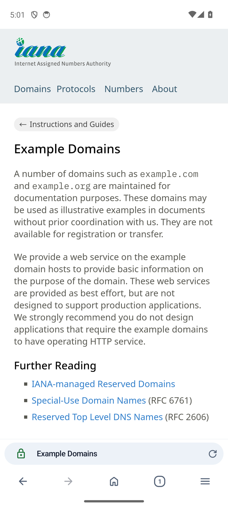
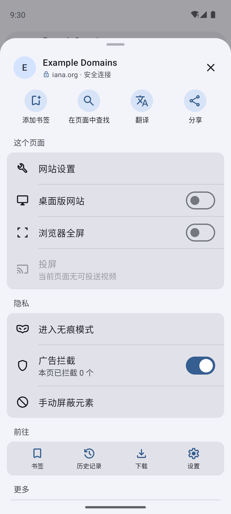
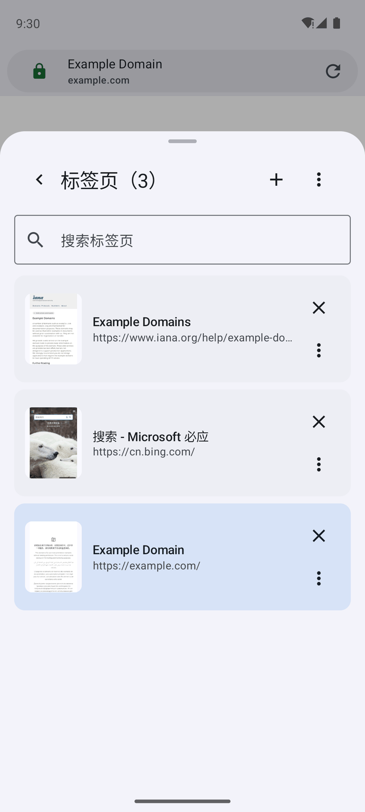
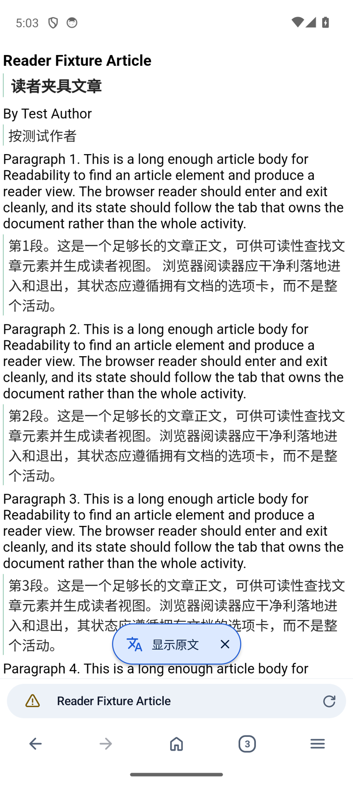
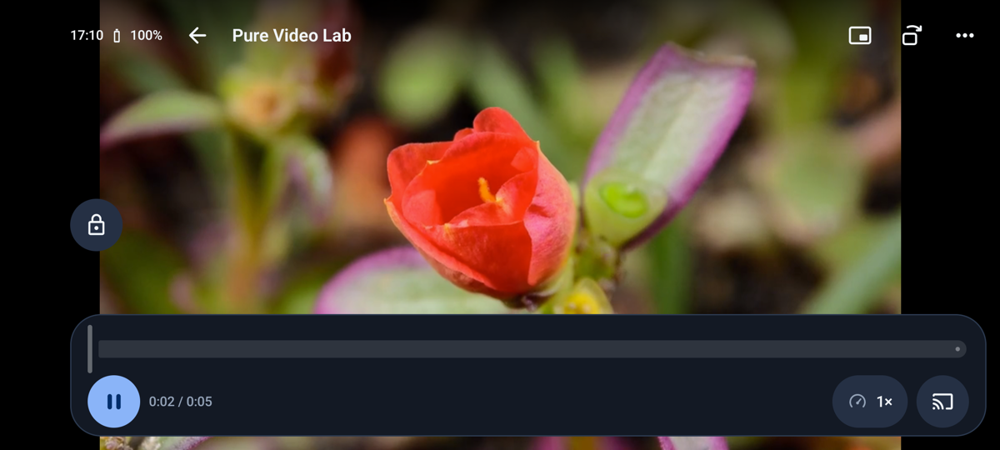
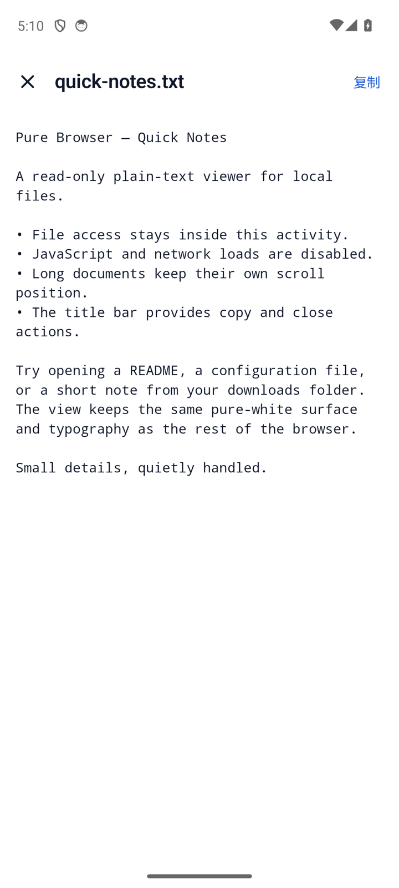
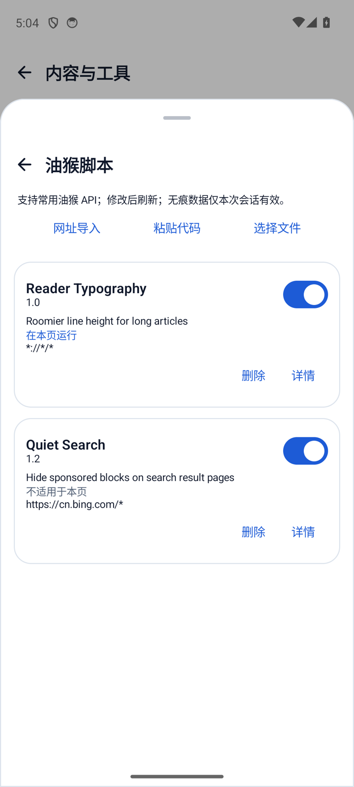
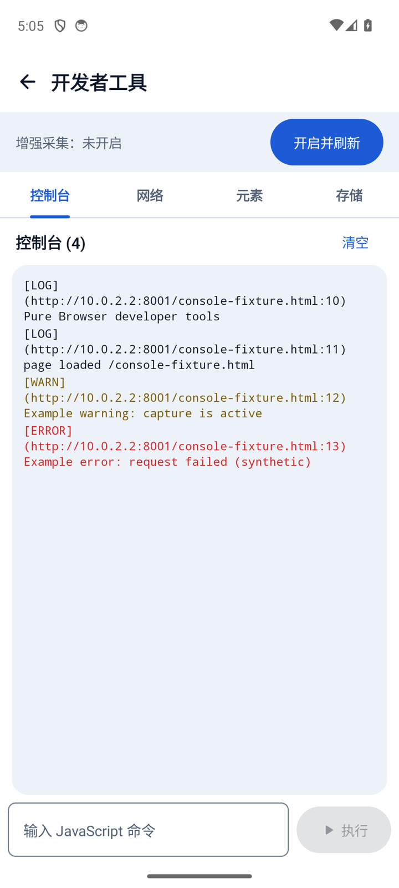

# Pure 浏览器

[中文](README.md) · [English](README.en.md)

[](https://github.com/Nobilta/pure-browser/actions/workflows/ci.yml)
[](https://github.com/Nobilta/pure-browser/releases/latest)
[](LICENSE)
[](#安装)

Pure 浏览器是一款开源的 Android 浏览器，基于系统内置的 WebView，界面采用 Material Design 3 规范设计。

**[下载最新版](https://github.com/Nobilta/pure-browser/releases/latest)** · [查看截图](#截图) · [反馈问题](https://github.com/Nobilta/pure-browser/issues)

支持 Android 10 及以上的 ARM64 设备（64 位 Android 系统）。

## 核心功能

- **增强型视频播放器**：支持倍速、亮度与音量手势、画中画、后台播放、DLNA 投屏；投屏列表中的所有资源均提供新标签播放和下载入口，播放及附件下载沿用可获取的原媒体请求来源信息，跳转遵守服务器的来源策略。
- **网页翻译**：支持全文双语对照翻译，选中翻译；内置免登录服务，也可配置自定义翻译API。
- **本地纯文本**：支持打开常见文本文件（`text/plain`、YAML、JSON、XML、Markdown、CSV 等）。
- **开发者工具**：控制台、网络请求详情、DOM 树与当前 DOM 源码、Cookies／Local Storage／Session Storage；全屏浏览，通过系统返回退出，详情文字支持长按选择复制；DOM 默认隐藏格式空白节点。增强采集按标签页开启并刷新，存储无需开启即可查看。
- **广告过滤与用户脚本**：内置过滤规则，可添加订阅、安装用户脚本；支持的 WebView 会提前应用元素隐藏规则，减少广告闪现。
- **标签与书签**：标签分组与搜索、页内查找、书签导入导出；书签显示已缓存的网站图标，长按多选后可通过左侧手柄拖动排序。
- **阅读与打印**：一键重排正文进入阅读模式；支持通过系统打印界面打印网页或另存为 PDF。
- **下载管理**：支持暂停续传、自选目录。
- **沉浸全屏**：隐藏系统栏和工具栏，网页铺满屏幕。
- **离线扫码**：支持使用相机或图片识别二维码，无需联网。
- **个性化**：自定义首页、地址栏位置、主题和三种界面语言；可按站点设置浏览器标识；设置可导出到文件并在其他设备导入。
- **隐私管理**：内置无痕浏览、按网站管理权限、清理浏览数据。

## 截图

浏览、菜单、标签与双语翻译：

| 浏览 | 菜单 | 标签 | 双语翻译 |
|---|---|---|---|
|  |  |  |  |

视频增强播放、本地文本、油猴脚本与开发者工具：

| 视频增强播放 | 本地纯文本 | 油猴脚本 | 开发者工具 |
|---|---|---|---|
|  |  |  |  |

详细功能、网站兼容性和无痕模式的限制见[功能说明](FEATURES.md)。

## 安装

1. 在手机上打开[最新版本](https://github.com/Nobilta/pure-browser/releases/latest)，在 **Assets（附件）** 中下载 `PureBrowser-v<版本>-release.apk`。
2. 打开下载的 APK；如果系统提示，请允许当前下载来源安装应用。
3. 按系统提示完成安装。

升级时直接安装新版即可，保留原有书签和设置，**无需先卸载旧版**。
应用也会在启动时检查更新，你可以在「设置 → 关于」关闭自动检查，或手动检查更新。

每个版本的变化见[更新日志](CHANGELOG.md)。

## 从源码构建

项目使用 Kotlin、Jetpack Compose 和 Rust。构建支持 macOS、Linux 和 Windows，
Windows 请在 Git Bash 中运行脚本。请先按[贡献指南](CONTRIBUTING.md#开发环境)准备 JDK、
Android SDK/NDK、Rust、Node.js 和 Python。

```bash
git clone https://github.com/Nobilta/pure-browser.git
cd pure-browser
./build-and-test.sh --quick      # 运行自动检查
./gradlew :app:assembleDebug     # 构建可安装的调试版
# ./build-and-test.sh --release  # 签名 Release 并运行发布检查
```

调试版位于 `app/build/outputs/apk/debug/app-debug.apk`，可与正式版同时安装。
默认构建 ARM64；模拟器配置见[测试指南](TESTING_GUIDE.md)，签名与发版见[发布指南](RELEASING.md)。
快速检查包含发布脚本测试；`--release` 还会签名并验证正式包。正式版本在本机签名并完成模拟器回归，推送至 `main` 且 CI 通过后，
使用 `release/publish.sh` 创建 GitHub Release 草稿，核对后手动发布为 latest。

想了解代码组织，可以从[架构说明](ARCHITECTURE.md)开始；其中说明了页面导航、下载记录存储和设置公共控件的职责边界。

## 反馈与贡献

遇到问题或有功能建议，欢迎[提交 Issue](https://github.com/Nobilta/pure-browser/issues)。
描述问题时，请附上应用版本、Android 版本和复现步骤。安全漏洞请按[安全策略](SECURITY.md)私下报告。

欢迎通过 Pull Request 改进项目，开始前可以阅读[贡献指南](CONTRIBUTING.md)与[行为准则](CODE_OF_CONDUCT.md)。

## 许可

项目代码使用 [MIT 许可](LICENSE)。过滤规则和其他第三方组件的许可见[第三方说明](THIRD_PARTY_NOTICES.md)。
